# minectl



A CLI to create and manage Minecraft servers on any Linux (or Windows with Docker) using Docker. No cloud, no accounts — just your machine and [itzg/minecraft-server](https://github.com/itzg/docker-minecraft-server).

## Quick start

```bash
# Create a Paper 1.21.1 server with 4GB RAM
minectl create --name survival --type paper --version 1.21.1 --memory 4G

# List servers
minectl list

# Start / stop / restart
minectl start survival
minectl stop survival
minectl restart survival

# One-off server command
minectl exec survival "say Hello"
```

## Requirements

- **Docker** — Engine 20.x+ running (e.g. `docker ps` works).
- **Go 1.26+** — only if building from source.

## Install

- **From source:** `go install github.com/Geordie1071-spec/minectl/cmd/minectl@latest`
- **Script:** `curl -sSL https://raw.githubusercontent.com/Geordie1071-spec/minectl/main/scripts/install.sh | bash`
- **Releases:** download the binary for your OS/arch from [Releases](https://github.com/Geordie1071-spec/minectl/releases).

Run `minectl` on its own for an overview of your servers and common commands. Output is plain text when piped or with `NO_COLOR` or `--no-color`.

### Updating

```bash
sudo minectl update            # latest release; restarts the panel service if it's running
minectl update --check         # just say whether there's a new version
```

The download is checked against the release's checksums before it replaces the binary. Minecraft servers keep running through an update. Admins also see a notice in the panel when a new version is out, with an **Update now** button: the panel replaces its own binary and restarts, and the page reloads when it's back. `install-service` keeps the panel's binary at `/opt/minectl/bin/minectl`, owned by the panel's user, and links `/usr/local/bin/minectl` to it, so the button works. Re-running the install script also updates, and restarts the panel.

A database written by a newer minectl isn't opened by an older one, so going back a version can't hide or damage your servers. `minectl update --version v2.0.1` installs a specific release.

### Uninstall

```bash
minectl uninstall              # worlds, backups and settings are kept
minectl uninstall --purge      # also delete them
```

This removes the panel service, closes router port forwards and playit.gg tunnels, stops and removes the Minecraft server containers, and removes the binary. `--purge` also deletes worlds, backups and settings; add `--keep-data` to keep the worlds and backups. Add `--yes` to skip the confirmation.

If the `minectl` binary is already gone, the same steps run from the script: `curl -sSL https://raw.githubusercontent.com/Geordie1071-spec/minectl/main/scripts/uninstall.sh | bash` (add `-s -- --purge` to purge).

### Install on your VPS (one command)

**Before installing, open the ports in your provider's console.** Most clouds filter traffic before it reaches the machine, and minectl doesn't touch your cloud account, so this one step is yours. Open TCP **25565-25575** for players, and **80** and **443** if you'll run the panel on a domain. The install script repeats where to do it once it knows which provider it's on.

| Provider | Easiest image (SSH user) | Open the ports | Also recommended |
| --- | --- | --- | --- |
| **Oracle Cloud** | Ubuntu (`ubuntu`) or Oracle Linux (`opc`); an Ampere A1 shape fits well in the free tier | Networking › Virtual cloud networks › your VCN › Security Lists › Add Ingress Rules, source `0.0.0.0/0` | Nothing: the installer opens the machine's own iptables or firewalld too |
| **AWS** | Ubuntu (`ubuntu`) or Amazon Linux (`ec2-user`) | EC2 › Instances › Security › the security group › Edit inbound rules, source `0.0.0.0/0` | Attach an Elastic IP, or the address changes when the instance stops and starts |
| **Google Cloud** | Debian or Ubuntu (your Google username, via the SSH button) | VPC network › Firewall › Create firewall rule, all instances, source `0.0.0.0/0`. For 80 and 443, tick "Allow HTTP/HTTPS traffic" on the VM | Promote the external IP to static, or it changes when the VM stops and starts |
| **Azure** | Ubuntu (`azureuser`) | The VM › Networking › Add inbound port rule | Nothing |
| **Hetzner, DigitalOcean, Vultr** | Ubuntu or Debian (`root`) | Nothing, unless you added a Cloud Firewall: then add the ports to it | Nothing |

On all of these, minectl works out the machine's public IP by itself, so the panel and `minectl list` show players the right address. On AWS, Google Cloud, Azure and Oracle the machine only sees a private IP, and minectl asks the provider (or, on Oracle and Azure, an IP lookup service) for the public one.

For a panel with HTTPS, point your domain's DNS A record at the machine before installing; `install-service` warns if it doesn't point there yet. If you log in as a normal user rather than root, log out and back in after the install so you can use Docker without sudo.

Then, on a fresh **Ubuntu, Debian, Amazon Linux, Oracle Linux, Rocky, Alma, RHEL or Fedora** server, run:

```bash
curl -sSL https://raw.githubusercontent.com/Geordie1071-spec/minectl/main/scripts/install.sh | bash
```

This installs **Docker** (if missing) and **minectl**, opens the machine's firewall (`firewalld`, `ufw`, or the plain `iptables` rules on Oracle Cloud's Ubuntu images) for Minecraft, labels the panel for SELinux where it's on, creates data dirs, and prints next steps. On the providers above it also prints the machine's public IP and the console steps for that provider. Then:

```bash
minectl create -n myserver -t paper -m 4G
minectl list
```

To skip Docker install (you already have it): `MINECTL_SKIP_DOCKER=1 curl -sSL ... | bash`  
To pin version: `MINECTL_VERSION=v2.0.0 curl -sSL ... | bash`

## Web panel

`minectl serve` runs a web panel and API from the same binary. Use it to manage servers from a browser and give friends limited access. From the panel you can:
- Create servers from a server type, a Modrinth search, or a CurseForge link, with live install progress.
- Use a live console, live CPU and memory graphs, and the player list (whitelist, op, kick, ban).
- Make and restore backups, manage mods and modpacks, resize, and upgrade.
- Schedule automatic backups, change game settings (MOTD, difficulty, max players...), and get a Discord message when a server crashes.

On a VPS with a domain pointed at it (ports 80 and 443 open), this installs minectl and the panel as a systemd service with automatic HTTPS:

```bash
curl -sSL https://raw.githubusercontent.com/Geordie1071-spec/minectl/main/scripts/install.sh | bash -s -- --domain panel.example.com
```

**Firewall:** open TCP **80** and **443** for the panel and **25565** for players (for example `sudo ufw allow 80,443,25565/tcp`).

It prints a one-time **setup token**. Open `https://panel.example.com/setup`, enter the token, and create your admin account. Until someone does, nobody else can claim the panel.

Without a domain the panel only listens on `127.0.0.1:8080`. Reach it through an SSH tunnel: `ssh -L 8080:localhost:8080 you@your-vps`, then open http://localhost:8080.

| | |
|---|---|
| `minectl serve` | Run the panel in the foreground (`--listen`, `--domain`, `--email`, `--trust-proxy`, `--public-address`) |
| `sudo minectl serve install-service` | Run it at boot with systemd (same flags, plus `--user`) |
| `minectl serve reset-password <user>` | Set a new random password if someone is locked out |

**Join address.** The panel shows players the address to type into Minecraft. It uses the panel's own hostname, or this machine's network IP when you open the panel at `localhost`. To set it yourself, for example to a domain pointed at the machine, pass `--public-address play.example.com`.

**Roles.** Admins can do everything. Other users only see the servers they've been given access to:
- **Operator:** start, stop, restart, console, backups, and managing players.
- **Viewer:** status, logs, stats, and the player list.

**Behind a reverse proxy** (nginx, Caddy): run `minectl serve --listen 127.0.0.1:8080 --trust-proxy`. Pass the original `Host` header through, and set `X-Forwarded-Proto: https`.

The CLI and the panel share the same state (`~/.minectl/minectl.db`), so servers created in one appear in the other. If one is already changing a server, the other is told it's busy.

### Running servers unattended

The panel also looks after servers while you're away. These run inside `minectl serve`, so use `install-service` to keep it running at boot.

**Scheduled backups.** Back up every hour, every 6 hours, or every day from a server's Backups tab, or with `minectl backup schedule survival daily` (`off` turns it off). The panel keeps the newest backups and deletes older ones. Change how many it keeps (1-100) under Panel settings.

**Crash alerts.** The panel watches Docker for servers that exit on their own and tells those apart from stops you asked for. It records the reason on the server's Overview, for example running out of memory or exiting with an error. Docker restarts a crashed server automatically. A server that crashes 4 times within 10 minutes is stopped instead, so it doesn't keep restarting. To get a message in Discord, paste a channel webhook URL into Panel settings and press **Send a test**. The webhook is stored on the server and never shown again.

**Game settings.** Change the MOTD, max players, difficulty, gamemode, view distance, PvP, hardcore, online mode, whitelist and flight from a server's Settings tab, or from the CLI:

```bash
minectl props survival                                   # show current values
minectl props set survival motd="Welcome!" difficulty=hard max-players=30
minectl props unset survival pvp                         # back to Minecraft's default
```

Saving restarts the server to apply the change. Unsetting a setting writes Minecraft's default back to `server.properties`. Settings minectl doesn't manage are left as they are.

### Hosting from home

Running minectl on your own computer? Make a server public so friends elsewhere can join:

```bash
minectl public survival            # or press "Make public" on the server's Overview
minectl public survival --off      # back to your network only
```

minectl first asks your router to forward the port (UPnP or NAT-PMP) and shows your public address. If the router has that turned off, or your internet provider shares one address between many customers (CGNAT, common on mobile and some fibre connections), it uses a free [playit.gg](https://playit.gg) tunnel instead. Link playit once, with `minectl playit link` or under Panel settings, and approve minectl in your browser. minectl then runs the playit agent in Docker and creates a tunnel for each server. Use `--via router` or `--via playit` to pick one.

On a VPS there's nothing to forward: the machine is already on the internet, and the panel says so. Open the server's port in the firewall instead. Some clouds (AWS, Google Cloud, Azure, Oracle) only show the machine a private IP; minectl asks the provider for the public one, so the panel and `minectl list` show the right join address without any flags. `--domain` or `--public-address` still take priority, for example to show players a domain instead of an IP.

The panel renews router forwards every 20 minutes, which also restores them after the router restarts. With only the CLI, run `minectl public` again after a router restart. Many routers can't loop back to their own public address, so on your own network join with the local address.

### Panel backup

The panel's own database, with users, roles, settings and API tokens, is copied every day to `~/.minectl/panel-backups/` (the last 7 are kept). Admins can also download a copy under Settings. Server worlds are backed up separately, per server. To restore, stop the panel and copy the backup over `~/.minectl/minectl.db`:

```bash
sudo systemctl stop minectl
cp ~/.minectl/panel-backups/minectl-20261127-120000.db ~/.minectl/minectl.db
sudo systemctl start minectl
```

The file contains password hashes and saved secrets, so keep it private.

### API

Everything the panel does goes through a JSON API under `/api/v1`. Create a personal token with `POST /api/v1/tokens` and send it as `Authorization: Bearer mct_...`. A token has the same permissions as its owner.

```bash
curl -H "Authorization: Bearer $TOKEN" https://panel.example.com/api/v1/servers
curl -H "Authorization: Bearer $TOKEN" -X POST https://panel.example.com/api/v1/servers \
  -d '{"name":"survival","type":"paper","memory":"auto","players":10}'
```

Long operations (create, start, stop, restart, backup, restore, upgrade, resize, modpack and mod changes) return `202` with a job. Follow it with `GET /api/v1/jobs/{id}/events`, a server-sent event stream. Live logs and stats are streamed the same way at `/api/v1/servers/{name}/logs` and `/stats`. Every change is recorded in the audit log (`GET /api/v1/audit?page=1&limit=25`, admins only; page 1 is the newest).

### Developing the panel

The React app lives in `web/`. Release binaries have it embedded; for a local build with the UI, run `make panel`. Without it, `go build` still works and serves a placeholder page.

```bash
minectl serve                 # API on 127.0.0.1:8080
npm --prefix web run dev      # UI with hot reload on http://localhost:5173, proxied to the API
make smoke                    # Playwright smoke test against the built binary
```

## Commands

| Command | Description |
|--------|-------------|
| `create` | Create and start a new server |
| `list` | List all servers |
| `start` / `stop` / `restart` | Lifecycle |
| `delete` | Remove container (use `--purge` to delete world data) |
| `exec` | Run a single command (e.g. `exec survival "op Steve"`) |
| `logs` | Tail logs (`--follow` to stream) |
| `stats` | CPU/memory usage |
| `backup create/list/restore` | Backups |
| `backup schedule` | Back up automatically: `hourly`, `6h`, `daily` or `off` (runs while the panel is running) |
| `props` / `props set` / `props unset` | Show or change game settings |
| `public` | Let friends join from the internet (router port forwarding or a playit.gg tunnel; `--off` to undo) |
| `playit link` / `playit unlink` | Link a playit.gg account for tunnels |
| `mods add/list` | Modrinth mods (Fabric/Forge) |
| `modpack set/info/search` | Modpack (Modrinth) |
| `upgrade` | Upgrade MC version |
| `resize` / `recommend` | Change or preview memory and CPU |
| `versions` | List available Minecraft versions for a server type |
| `serve` | Run the web panel and API |
| `update` | Update minectl to the latest release (`--check` to only look) |
| `uninstall` | Remove minectl, the panel service and the server containers (`--purge` to delete worlds too) |

## Config and data

- Config: `~/.minectl/` (or `MINECTL_CONFIG_DIR`).
- Servers state and settings: `~/.minectl/minectl.db` (SQLite). Older `servers.json` / `config.json` files are imported automatically on first run and renamed to `*.migrated`.
- World data: `/opt/minectl/servers/<name>` by default (configurable).

## Testing (Docker required)

With Docker running, you can verify:

```bash
# 1. List servers (from store; no Docker needed)
minectl list
minectl list --all    # include stopped

# 2. Create and start a vanilla/Paper server
minectl create -n my-server -t paper -v 1.21.1 -m 4G -p 25565

# 3. Create a server with a Modrinth modpack (one command)
minectl create -n modpack-server -t fabric -v 1.21.1 -m 4G -p 25566 --modpack all-of-fabric-6

# Or create first, then set modpack and recreate container
minectl create -n other -t fabric -v 1.21.1 -m 2G --no-start
minectl modpack set other all-of-fabric-6
minectl start other

# 4. Check status and start/stop
minectl list
minectl start my-server
minectl stop my-server
```

## License

MIT.
